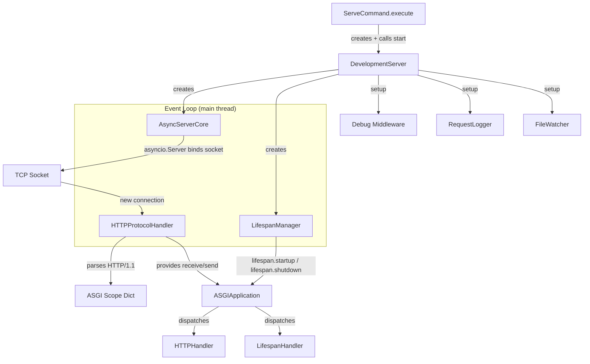
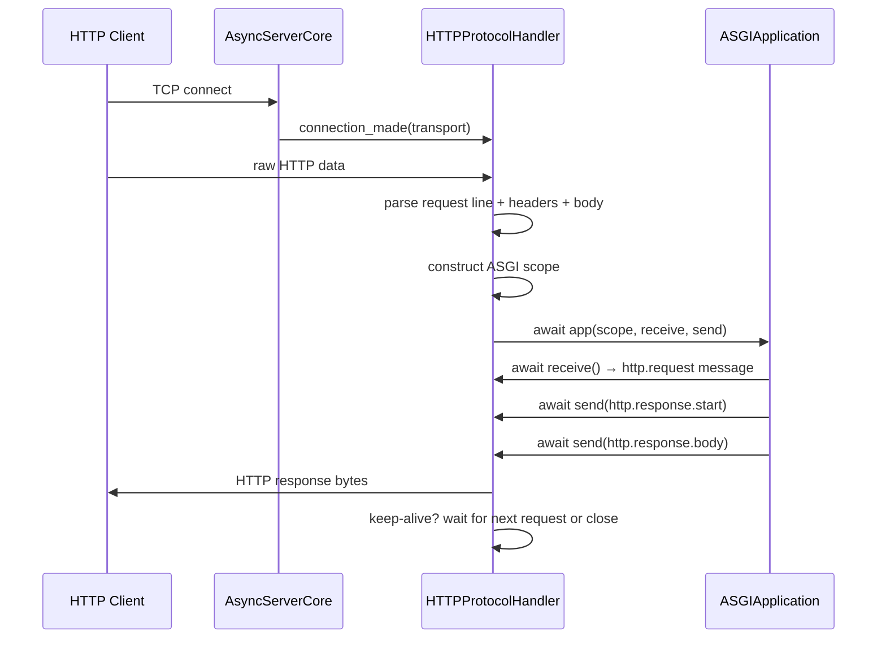
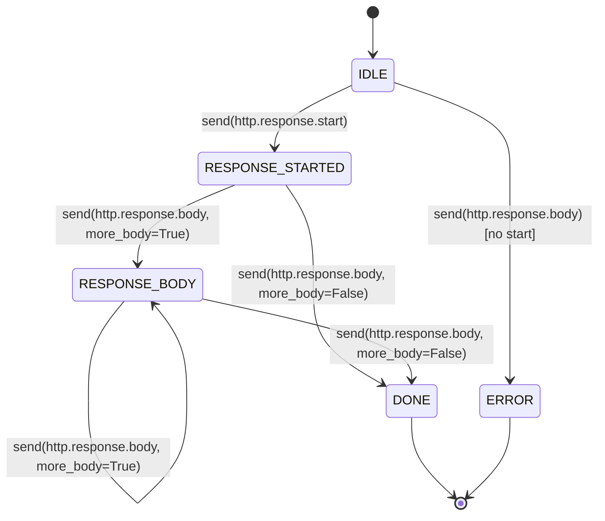

# Design Document: Development Server (ASGI)

## Overview

The development server feature enhances the existing `DevelopmentServer` class to actually bind a TCP socket, accept HTTP connections, parse HTTP/1.1 requests, translate them into ASGI scope dictionaries, and invoke the `ASGIApplication` callable. Currently, `DevelopmentServer` manages lifecycle concerns (debug middleware, request logging, file watching) but delegates no actual serving. The `WSGIServer` handles real socket-based serving but only for WSGI apps.

This design introduces three new modules:

- **`asyncservercore.py`** — An asyncio-based TCP server that binds a socket and accepts connections, delegating each to an HTTP protocol handler.
- **`httpprotocolhandler.py`** — An `asyncio.Protocol` implementation that parses HTTP/1.1 requests, constructs ASGI scopes, and provides `receive`/`send` callables to the ASGI application.
- **`lifespanmanager.py`** — Manages ASGI lifespan startup/shutdown events against the application.

The existing `DevelopmentServer.start()` method is enhanced to create an `AsyncServerCore`, run the asyncio event loop (blocking the calling thread), and integrate with the existing `ServeCommand` CLI. Signal handling (SIGINT/SIGTERM) triggers graceful shutdown. The design uses only Python standard library (`asyncio`, `socket`) with no external dependencies.

### Design Decision: asyncio.Protocol vs asyncio.StreamReader

We use `asyncio.Protocol` (the transport/protocol callback API) rather than `asyncio.start_server` with streams. The protocol API gives direct control over `connection_made`, `data_received`, and `connection_lost` callbacks, which maps cleanly to HTTP/1.1 connection lifecycle and allows incremental parsing without buffering entire requests in memory. This also mirrors how production ASGI servers like uvicorn structure their protocol layer.

### Design Decision: Enhance DevelopmentServer, Don't Replace It

The existing `DevelopmentServer` already handles debug middleware setup, request logging configuration, file watcher setup, and port availability checking. Rather than duplicating this, we enhance `start()` to create and run the `AsyncServerCore` after the existing setup steps, and enhance `stop()` to shut down the core. The `_restart_server()` method is updated to stop/start the `AsyncServerCore` for reload.

### Design Decision: Blocking Event Loop on Main Thread

Following the pattern of `WSGIServer.serve_forever()`, `DevelopmentServer.start()` blocks the calling thread by running `asyncio.run()` (or `loop.run_forever()`). This matches the `ServeCommand` expectation that `server.start()` blocks until the server is stopped. Signal handlers are registered on the event loop via `loop.add_signal_handler()`.

## Architecture



### Connection Flow




## Components and Interfaces

### AsyncServerCore (`source/packages/automojo/webworks/devexp/server/asyncservercore.py`)

The asyncio-based TCP server that binds a socket and manages connections.

| Member | Type | Description |
|---|---|---|
| `__init__(app, host, port, shutdown_timeout, keepalive_timeout)` | constructor | Stores config, initializes state |
| `async start()` | method | Creates `asyncio.Server`, binds socket, starts accepting connections |
| `async stop()` | method | Stops accepting, waits for in-flight requests (up to `shutdown_timeout`), closes server |
| `server` | property | The underlying `asyncio.Server` instance or `None` |
| `is_running` | property | Whether the server is currently accepting connections |
| `active_connections` | property | Count of active `HTTPProtocolHandler` instances |
| `_create_protocol()` | method | Factory method returning a new `HTTPProtocolHandler` |
| `register_connection(handler)` | method | Tracks an active connection |
| `unregister_connection(handler)` | method | Removes a tracked connection |

The `start()` method calls `loop.create_server()` with the protocol factory. The `stop()` method calls `server.close()`, then waits up to `shutdown_timeout` (default 5s) for active connections to drain, then forcibly closes remaining transports.

### HTTPProtocolHandler (`source/packages/automojo/webworks/devexp/server/httpprotocolhandler.py`)

An `asyncio.Protocol` subclass that handles a single TCP connection. Parses HTTP/1.1, constructs ASGI scopes, and bridges the ASGI receive/send interface to raw TCP.

| Member | Type | Description |
|---|---|---|
| `__init__(app, server_host, server_port, debug, on_close)` | constructor | Stores app reference and server address |
| `connection_made(transport)` | callback | Records client address, stores transport |
| `data_received(data)` | callback | Feeds data to the incremental HTTP parser |
| `connection_lost(exc)` | callback | Cleans up, calls `on_close` |
| `_parse_request_line(line)` | method | Extracts method, target, version from request line |
| `_parse_headers(header_block)` | method | Parses headers into list of `(name_bytes, value_bytes)` tuples |
| `_build_scope(method, path, query, version, headers)` | method | Constructs the ASGI scope dictionary |
| `async _handle_request()` | method | Calls `app(scope, receive, send)` and handles errors |
| `async _receive()` | method | Returns `http.request` message with body and `more_body` flag |
| `async _send(message)` | method | Handles `http.response.start` and `http.response.body` messages |
| `_write_response(status, headers, body)` | method | Serializes HTTP response to bytes and writes to transport |
| `_should_keep_alive(version, headers)` | method | Determines if connection should stay open |
| `_send_error_response(status_code, message)` | method | Writes a simple error response and closes |

**Parsing Strategy**: The handler uses an incremental buffer. `data_received` appends to the buffer. When a complete request line + headers block (terminated by `\r\n\r\n`) is found, parsing proceeds. Body reading uses Content-Length or chunked transfer decoding. Limits: request line max 8192 bytes, header block max 32768 bytes.

**ASGI Scope Construction**: The scope dictionary follows the ASGI 3.0 HTTP connection scope spec:

```python
{
    "type": "http",
    "asgi": {"version": "3.0"},
    "http_version": "1.1",        # or "1.0"
    "method": "GET",              # uppercase
    "path": "/some/path",         # string, URL-decoded
    "raw_path": b"/some/path",    # bytes, as received
    "root_path": "",
    "scheme": "http",
    "query_string": b"key=val",   # bytes, without leading ?
    "headers": [                  # list of [name, value] byte pairs
        [b"host", b"localhost:8000"],
        [b"content-type", b"text/plain"],
    ],
    "server": ["127.0.0.1", 8000],
    "client": ["192.168.1.5", 54321],
}
```

**Send Callable State Machine**: The `_send` method tracks state to enforce ordering:
1. Initial state: expects `http.response.start`
2. After start: expects `http.response.body`
3. When `more_body` is `False` or absent: response is finalized

### LifespanManager (`source/packages/automojo/webworks/devexp/server/lifespanmanager.py`)

Manages ASGI lifespan protocol events.

| Member | Type | Description |
|---|---|---|
| `__init__(app)` | constructor | Stores app reference |
| `async startup()` | method | Sends `lifespan.startup`, waits for complete/failed |
| `async shutdown()` | method | Sends `lifespan.shutdown`, waits for complete/failed |
| `startup_complete` | property | Whether startup succeeded |
| `startup_failed` | property | Whether startup failed |
| `failure_message` | property | Error message if startup/shutdown failed |

The manager creates a lifespan scope `{"type": "lifespan", "asgi": {"version": "3.0"}}` and calls `app(scope, receive, send)`. It uses `asyncio.Queue` objects for the receive/send channels. If the app raises an exception during lifespan handling (indicating it doesn't support lifespan), the manager catches it and proceeds as if startup succeeded.

### Enhanced DevelopmentServer (`source/packages/automojo/webworks/devexp/server/devserver.py`)

Changes to the existing class:

| Method | Change |
|---|---|
| `start()` | After existing setup, creates `AsyncServerCore` and `LifespanManager`, runs `asyncio.run(self._run_async())` to block |
| `stop()` | Signals the async core to stop |
| `_run_async()` | New async method: runs lifespan startup, starts server core, installs signal handlers, awaits shutdown event, runs lifespan shutdown, stops server core |
| `_restart_server()` | Updated to stop/start the `AsyncServerCore` for file-change reload |
| `_setup_signal_handlers(loop)` | New method: registers SIGINT/SIGTERM on the event loop |

New instance variables:
- `_server_core: Optional[AsyncServerCore]`
- `_lifespan_manager: Optional[LifespanManager]`
- `_shutdown_event: Optional[asyncio.Event]`

## Data Models

No new persistent data models are introduced. All data flows through existing framework types and transient in-memory structures:

| Type | Module | Usage |
|---|---|---|
| ASGI Scope `dict` | constructed by `HTTPProtocolHandler` | Connection metadata passed to `ASGIApplication` |
| ASGI Message `dict` | `http.request`, `http.response.start`, `http.response.body` | Messages exchanged via receive/send callables |
| Lifespan Scope `dict` | constructed by `LifespanManager` | Lifespan event scope |
| `PortInUseError` | `devserver.py` (existing) | Raised when port is unavailable |
| `Request` | `automojo.webworks.routing.request` | Parsed request object (used by HTTPHandler) |
| `Response` | `automojo.webworks.routing.response` | Response object (used by HTTPHandler) |

### HTTP Parser Internal State

The `HTTPProtocolHandler` maintains parsing state as an enum:

```python
class _ParseState:
    AWAITING_REQUEST_LINE = "awaiting_request_line"
    AWAITING_HEADERS = "awaiting_headers"
    AWAITING_BODY = "awaiting_body"
    PROCESSING = "processing"
    RESPONSE_STARTED = "response_started"
    RESPONSE_BODY = "response_body"
    DONE = "done"
```

### ASGI Send State Machine




## Correctness Properties

*A property is a characteristic or behavior that should hold true across all valid executions of a system — essentially, a formal statement about what the system should do. Properties serve as the bridge between human-readable specifications and machine-verifiable correctness guarantees.*

### Property 1: HTTP Request Parsing Round Trip

*For any* valid HTTP method, request target, HTTP version, and set of headers, serializing them into a raw HTTP request line and header block, then parsing with `HTTPProtocolHandler._parse_request_line` and `_parse_headers`, should recover the original method, target, version, and header name/value pairs.

**Validates: Requirements 2.1, 2.2**

### Property 2: Content-Length Body Integrity

*For any* HTTP request with a Content-Length header and a body of exactly that many bytes, the `HTTPProtocolHandler` should parse a body whose length equals the Content-Length value and whose content matches the original bytes.

**Validates: Requirements 2.3**

### Property 3: Chunked Transfer Decoding Round Trip

*For any* byte sequence, encoding it as HTTP chunked transfer encoding and then decoding with the `HTTPProtocolHandler` chunked decoder should produce the original byte sequence.

**Validates: Requirements 2.4**

### Property 4: ASGI Scope Completeness and Type Correctness

*For any* valid HTTP request (method, path, query string, version, headers, server address, client address), the constructed ASGI scope dictionary should contain all required keys (`type`, `asgi`, `http_version`, `method`, `path`, `raw_path`, `root_path`, `scheme`, `query_string`, `headers`, `server`, `client`), with `type` equal to `"http"`, `path` as a `str`, `query_string` as `bytes`, `raw_path` as `bytes`, `server` as a two-element list of `[str, int]`, and `client` as a two-element list of `[str, int]`.

**Validates: Requirements 1.5, 3.1, 3.2, 3.4, 3.6, 3.7**

### Property 5: Query String Separation

*For any* request target containing a `?` character, the constructed ASGI scope should have `path` equal to the portion before the first `?` and `query_string` equal to the bytes of the portion after the first `?`.

**Validates: Requirements 3.3**

### Property 6: Header Lowercase Normalization

*For any* set of HTTP headers with arbitrary casing, each entry in the ASGI scope `headers` list should be a two-element list of byte strings where the name is the lowercase version of the original header name and the value is preserved as-is.

**Validates: Requirements 3.5**

### Property 7: Receive Callable Body Delivery

*For any* request body, the sequence of messages returned by the `receive` callable should have type `"http.request"`, the concatenation of all `body` fields should equal the original request body, and the final message should have `more_body` set to `False`.

**Validates: Requirements 4.1, 4.2**

### Property 8: HTTP Response Serialization

*For any* valid HTTP status code, set of response headers, and body bytes, the `_write_response` method should produce bytes that form a valid HTTP/1.1 response: a status line with the correct code, all headers present, a blank line separator, and the body bytes.

**Validates: Requirements 4.4**

### Property 9: Debug Mode Error Response Detail Control

*For any* unhandled exception with a type name, message, and traceback, the HTTP 500 response body should contain the exception type, message, and traceback text when debug mode is enabled, and should contain none of those details when debug mode is disabled.

**Validates: Requirements 8.2, 8.3**

### Property 10: Request Log Format

*For any* HTTP method, request path, status code, and elapsed time, the `RequestLogger._format_log` output should be a single line matching the format `"{method} {path} {status_code} {elapsed_ms}ms"` and should contain all four values.

**Validates: Requirements 9.1, 9.2**

### Property 11: Keep-Alive Decision

*For any* HTTP request with a given HTTP version (`"1.0"` or `"1.1"`) and Connection header value (absent, `"keep-alive"`, or `"close"`), the `_should_keep_alive` method should return `True` for HTTP/1.1 with absent or `"keep-alive"` Connection header, `False` for HTTP/1.1 with `"close"`, `False` for HTTP/1.0 with absent or `"close"` Connection header, and `True` for HTTP/1.0 with `"keep-alive"`.

**Validates: Requirements 11.1, 11.2, 11.3**

### Property 12: Connection Acceptance Scaling

*For any* number of concurrent TCP connections (within reasonable bounds), the `AsyncServerCore` should accept all connections and create a distinct `HTTPProtocolHandler` for each, with `active_connections` equal to the number of open connections.

**Validates: Requirements 1.2**

### Property 13: Reload Restart Count Increment

*For any* sequence of successful file-change reloads, the `restart_count` property should equal the number of successful reloads performed.

**Validates: Requirements 10.4**

## Error Handling

| Scenario | Component | Behavior |
|---|---|---|
| Port already in use | `DevelopmentServer.start()` | Raises `PortInUseError` (existing behavior) |
| Malformed request line | `HTTPProtocolHandler` | Sends 400 Bad Request, closes connection |
| Request line exceeds 8192 bytes | `HTTPProtocolHandler` | Sends 400 Bad Request, closes connection |
| Header block exceeds 32768 bytes | `HTTPProtocolHandler` | Sends 431 Request Header Fields Too Large, closes connection |
| Send body before start | `HTTPProtocolHandler._send()` | Logs error, closes connection |
| Unhandled exception (debug on) | `HTTPProtocolHandler._handle_request()` | Sends 500 with exception type, message, traceback as plain text |
| Unhandled exception (debug off) | `HTTPProtocolHandler._handle_request()` | Sends generic 500 Internal Server Error |
| Lifespan startup failed | `LifespanManager.startup()` | Logs failure message, `DevelopmentServer` stops server |
| App doesn't support lifespan | `LifespanManager.startup()` | Catches exception, proceeds as successful |
| SyntaxError/ImportError on reload | `DevelopmentServer._restart_server()` | Logs error, continues watching (existing behavior enhanced) |
| Keep-alive idle timeout (30s) | `HTTPProtocolHandler` | Closes connection silently |
| Graceful shutdown timeout (5s) | `AsyncServerCore.stop()` | Forcibly closes remaining transports |
| SIGINT/SIGTERM received | `DevelopmentServer._run_async()` | Sets shutdown event, triggers graceful shutdown |

### Error Response Format

Error responses generated by the `HTTPProtocolHandler` (400, 431, 500) use a minimal HTTP response format:

```
HTTP/1.1 {status_code} {reason}\r\n
Content-Type: text/plain; charset=utf-8\r\n
Content-Length: {body_length}\r\n
Connection: close\r\n
\r\n
{error_message}
```

## Testing Strategy

### Testing Framework

All tests use the `testbase` framework as specified in the project conventions. No pytest, unittest, or hypothesis. Property-based test iterations are implemented via loops within test functions (minimum 100 iterations per property).

### Unit Tests

Unit tests cover specific examples, edge cases, and integration points:

1. **HTTP Parsing Edge Cases**
   - Malformed request line returns 400
   - Request line exceeding 8192 bytes returns 400
   - Header block exceeding 32768 bytes returns 431
   - Empty body with Content-Length: 0

2. **ASGI Scope Construction Examples**
   - GET request to `/` produces correct scope
   - POST request with body produces scope with correct Content-Length header
   - Request with query string `/search?q=test` splits correctly

3. **Send State Machine Errors**
   - Sending `http.response.body` before `http.response.start` logs error and closes

4. **Lifespan Protocol**
   - App that sends `lifespan.startup.complete` — server starts
   - App that sends `lifespan.startup.failed` — server stops with error
   - App that raises on lifespan scope — server proceeds

5. **Graceful Shutdown**
   - Server stops accepting after `stop()` is called
   - Port is released after shutdown
   - In-flight request completes within timeout

6. **Keep-Alive**
   - Idle connection closed after 30 seconds
   - Multiple requests on single HTTP/1.1 connection

7. **Reload**
   - SyntaxError during reload logs error and continues
   - Successful reload increments restart_count

8. **ServeCommand Integration**
   - PortInUseError returns EXIT_ERROR
   - Normal shutdown returns EXIT_SUCCESS

### Property-Based Tests

Each property test runs a minimum of 100 iterations with randomly generated inputs. Tests reference the design property they validate.

| Test | Property | Description |
|---|---|---|
| `test_property_parse_request_round_trip` | Property 1 | Generate random valid HTTP methods, paths, versions, headers; serialize to raw bytes; parse; verify recovery |
| `test_property_content_length_body` | Property 2 | Generate random body bytes with matching Content-Length; parse; verify body matches |
| `test_property_chunked_round_trip` | Property 3 | Generate random bytes; encode as chunked; decode; verify identity |
| `test_property_scope_completeness` | Property 4 | Generate random request parameters; build scope; verify all keys present with correct types |
| `test_property_query_string_split` | Property 5 | Generate random paths with query strings; build scope; verify path/query_string split |
| `test_property_header_lowercase` | Property 6 | Generate random headers with mixed case; build scope; verify lowercase names |
| `test_property_receive_body_delivery` | Property 7 | Generate random bodies; call receive sequence; verify concatenation and final more_body=False |
| `test_property_response_serialization` | Property 8 | Generate random status codes, headers, bodies; serialize; verify valid HTTP format |
| `test_property_debug_error_control` | Property 9 | Generate random exceptions; verify 500 response contains/excludes details based on debug flag |
| `test_property_log_format` | Property 10 | Generate random method, path, status, time; format log; verify format matches |
| `test_property_keep_alive_decision` | Property 11 | Generate all combinations of version and Connection header; verify keep-alive decision |
| `test_property_connection_acceptance` | Property 12 | Generate random connection counts; connect; verify active_connections matches |
| `test_property_reload_count` | Property 13 | Perform random number of reloads; verify restart_count matches |

### Test Organization

```
source/testroots/automojo/tests/singlehost/webworks/
└── devexp/
    └── server/
        ├── test_httpprotocolhandler.py    # HTTP parsing unit + property tests
        ├── test_asyncservercore.py        # Server core unit + property tests
        ├── test_lifespanmanager.py        # Lifespan protocol unit tests
        ├── test_devserver.py              # DevelopmentServer integration tests
        └── test_servecommand.py           # CLI command tests
```

### Property Test Tagging

Each property test includes a comment referencing the design property:

```python
def test_property_parse_request_round_trip():
    # Feature: development-server, Property 1: HTTP Request Parsing Round Trip
    for _ in range(100):
        method = random_http_method()
        path = random_path()
        # ... generate, serialize, parse, assert
    return
```
