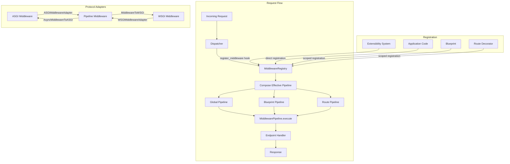

# Design Document: Middleware Pipeline

## Overview

This design formalizes the middleware pipeline for automojo-webworks, unifying the existing `MiddlewarePipeline` in `routing.middleware`, the `WSGIMiddlewareWrapper` in `wsgi.middleware`, and the `register_middleware` hook in the extensibility system into a cohesive middleware layer.

The current codebase already has the core building blocks:
- `routing.middleware.MiddlewarePipeline` with `Middleware`/`AsyncMiddleware` protocols, positional insertion, sync/async execution
- `wsgi.middleware.WSGIMiddlewareWrapper` for WSGI-style wrapping
- `extensibility.componenthooks.ComponentRegistrationHooks.fire_register_middleware` for extension-based middleware registration
- `routing.dispatcher.Dispatcher` that invokes `pipeline.execute()` / `pipeline.execute_async()` during dispatch
- `asgi.httphandler.HTTPHandler` that maintains its own middleware list and builds a chain

This design extends these foundations with:
1. A `MiddlewareRegistry` for scoped middleware management (global, blueprint, route)
2. A `MiddlewareContext` attached to requests for contextual middleware decisions
3. ASGI/WSGI adapter classes for protocol bridging
4. A `MiddlewareFactory` pattern for configurable middleware creation
5. Pipeline serialization/deserialization for configuration-driven setup
6. Built-in middleware: CORS, Request Logging, Error Normalization
7. Enhanced `MiddlewareEntry` with priority and scope metadata
8. Pipeline introspection via `__len__`, `__iter__`, `__repr__`, and registry queries

### Design Rationale

The existing `MiddlewarePipeline` already handles ordered execution, positional insertion, and sync/async dispatch. Rather than replacing it, this design enhances it with priority-based ordering within positional groups, scope metadata on entries, and serialization support. The `MiddlewareRegistry` is a new component that sits above the pipeline, managing scoped registration and composing effective pipelines per-request by combining global, blueprint, and route middleware. This layered approach preserves backward compatibility with existing code that uses `MiddlewarePipeline` directly.

## Architecture



### Module Layout

All new middleware pipeline code lives under `source/packages/automojo/webworks/routing/` since the pipeline is fundamentally a routing concern. Built-in middleware lives in a new `middleware/` subpackage under `routing/`.

```
source/packages/automojo/webworks/routing/
├── middleware.py              # Enhanced: MiddlewarePipeline, MiddlewareEntry, protocols
├── middlewarecontext.py       # NEW: MiddlewareContext
├── middlewareregistry.py      # NEW: MiddlewareRegistry
├── middlewareadapters.py      # NEW: ASGI/WSGI adapters
├── middlewarefactory.py       # NEW: MiddlewareFactory helpers
├── middleware/                # NEW: Built-in middleware subpackage
│   ├── __init__.py
│   ├── cors.py                # CORSMiddleware
│   ├── logging.py             # RequestLoggingMiddleware
│   └── errornormalization.py  # ErrorNormalizationMiddleware
└── ...existing files...
```

Tests mirror this structure under `source/testroots/automojo/tests/singlehost/webworks/routing/`.

## Components and Interfaces

### 1. Enhanced Middleware Protocols (routing/middleware.py)

The existing `Middleware` and `AsyncMiddleware` protocols remain unchanged. The `MiddlewareEntry` is enhanced with `priority` and `scope` fields.

```python
@runtime_checkable
class Middleware(Protocol):
    """
        Protocol for synchronous middleware components.
    """
    name: str

    def __call__(
        self,
        request: Request,
        call_next: Callable[[Request], Response]
    ) -> Response:
        ...


@runtime_checkable
class AsyncMiddleware(Protocol):
    """
        Protocol for asynchronous middleware components.
    """
    name: str

    async def __call__(
        self,
        request: Request,
        call_next: Callable[[Request], Awaitable[Response]]
    ) -> Response:
        ...
```

### 2. Enhanced MiddlewareEntry (routing/middleware.py)

```python
class MiddlewareEntry:
    """
        Internal record associating a middleware callable with its name,
        priority, and scope metadata.
    """

    def __init__(
        self,
        middleware: Union[Middleware, Callable],
        name: Optional[str] = None,
        priority: int = 50,
        scope: str = "global"
    ):
        ...

    @property
    def middleware(self) -> Union[Middleware, Callable]: ...

    @property
    def name(self) -> Optional[str]: ...

    @property
    def priority(self) -> int: ...

    @property
    def scope(self) -> str: ...

    def as_dict(self) -> Dict[str, Any]:
        """
            Return a dictionary with keys 'name', 'priority', and 'scope'.
        """
        ...
```

### 3. Enhanced MiddlewarePipeline (routing/middleware.py)

The existing `MiddlewarePipeline` is extended with priority-based ordering, serialization, and enhanced introspection.

```python
class MiddlewarePipeline:
    """
        Ordered chain of middleware components.
    """

    def __init__(self): ...

    def add(
        self,
        middleware: Union[Middleware, Callable],
        name: Optional[str] = None,
        position: str = "end",
        priority: int = 50,
        scope: str = "global"
    ) -> None:
        """
            Add middleware with optional priority for ordering within
            the same positional group.
        """
        ...

    def remove(self, name: str) -> None: ...

    def execute(self, request: Request, handler: Callable) -> Response: ...

    async def execute_async(self, request: Request, handler: Callable) -> Response: ...

    def get_names(self) -> List[Optional[str]]: ...

    def __len__(self) -> int: ...

    def __iter__(self): ...

    def __repr__(self) -> str: ...

    def as_dict(self) -> List[Dict[str, Any]]:
        """
            Return a list of dictionaries describing each MiddlewareEntry.
        """
        ...

    def to_json(self) -> str:
        """
            Serialize the pipeline configuration to a JSON string.
        """
        ...

    @classmethod
    def from_config(cls, config: List[Dict[str, Any]], factory_registry: Optional[Dict[str, Callable]] = None) -> "MiddlewarePipeline":
        """
            Reconstruct a pipeline from a list of middleware configuration
            dictionaries. Requires a factory_registry mapping middleware
            names to factory callables for instantiation.
        """
        ...
```

### 4. MiddlewareContext (routing/middlewarecontext.py)

```python
class MiddlewareContext:
    """
        Contextual information available to middleware during request processing.
    """

    def __init__(
        self,
        endpoint_descriptor: Optional[EndpointDescriptor] = None,
        scope: str = "global",
        config: Optional[Any] = None,
        logger: Optional[logging.Logger] = None
    ):
        ...

    @property
    def endpoint_descriptor(self) -> Optional[EndpointDescriptor]: ...

    @property
    def scope(self) -> str: ...

    @property
    def config(self) -> Optional[Any]: ...

    @property
    def logger(self) -> logging.Logger: ...
```

The `MiddlewareContext` is attached to the `Request` object as `request.middleware_context`. This requires adding a `middleware_context` attribute to the `Request` class (initialized to `None` in the constructor, set by the `Dispatcher` before pipeline execution).

### 5. MiddlewareRegistry (routing/middlewareregistry.py)

```python
class MiddlewareRegistry:
    """
        Central registry that collects, orders, and provides access to
        all registered middleware across scopes.
    """

    def __init__(self): ...

    def register(
        self,
        middleware: Union[Middleware, Callable],
        name: Optional[str] = None,
        scope: str = "global",
        scope_key: Optional[str] = None,
        priority: int = 50,
        position: str = "end"
    ) -> None:
        """
            Register middleware at a given scope.

            :param middleware: The middleware callable.
            :param name: Optional name for the middleware.
            :param scope: One of "global", "blueprint", "route".
            :param scope_key: Blueprint name or route path for scoped middleware.
            :param priority: Numeric priority (lower executes first).
            :param position: Positional hint ("start", "end", "before:<name>", "after:<name>").
        """
        ...

    def get_middleware_by_scope(self, scope: str, scope_key: Optional[str] = None) -> List[MiddlewareEntry]:
        """
            Query registered middleware by scope.
        """
        ...

    def compose_pipeline(
        self,
        blueprint_name: Optional[str] = None,
        route_path: Optional[str] = None
    ) -> MiddlewarePipeline:
        """
            Compose the effective pipeline for a request by combining
            global, then blueprint, then route middleware.
        """
        ...

    def list_by_scope(self) -> Dict[str, List[MiddlewareEntry]]:
        """
            List all registered middleware grouped by scope.
        """
        ...

    def export_effective_pipeline(self, route_path: str, blueprint_name: Optional[str] = None) -> List[str]:
        """
            Export the effective pipeline for a given route path as
            an ordered list of middleware names.
        """
        ...

    def get_registered_components(self, hook_name: str) -> List[Any]:
        """
            Retrieve all middleware registered via the extensibility system.
        """
        ...
```

### 6. Protocol Adapters (routing/middlewareadapters.py)

```python
class ASGIMiddlewareAdapter:
    """
        Wraps an ASGI middleware (scope, receive, send) to conform to
        the AsyncMiddleware protocol used by MiddlewarePipeline.
    """

    def __init__(self, asgi_middleware: Callable, name: str = ""): ...

    @property
    def name(self) -> str: ...

    async def __call__(self, request: Request, call_next: Callable) -> Response: ...


class AsyncMiddlewareToASGI:
    """
        Wraps an AsyncMiddleware to conform to the ASGI middleware protocol
        (scope, receive, send) for use with external ASGI servers.
    """

    def __init__(self, middleware: AsyncMiddleware, app: Callable): ...

    async def __call__(self, scope: Dict, receive: Callable, send: Callable) -> None: ...


class WSGIMiddlewareAdapter:
    """
        Wraps a WSGI middleware factory to conform to the Middleware protocol
        used by MiddlewarePipeline.
    """

    def __init__(self, wsgi_factory: Callable, name: str = ""): ...

    @property
    def name(self) -> str: ...

    def __call__(self, request: Request, call_next: Callable) -> Response: ...


class MiddlewareToWSGI:
    """
        Wraps a Middleware to conform to the WSGI middleware factory pattern
        for use with external WSGI servers.
    """

    def __init__(self, middleware: Middleware): ...

    def __call__(self, app: Callable) -> Callable: ...
```

### 7. Middleware Factory (routing/middlewarefactory.py)

```python
def create_middleware(
    factory: Callable[..., Union[Middleware, AsyncMiddleware]],
    **config: Any
) -> Union[Middleware, AsyncMiddleware]:
    """
        Instantiate middleware from a factory callable with configuration.
        Validates that the returned instance conforms to the Middleware
        or AsyncMiddleware protocol.

        :param factory: A callable that accepts config kwargs and returns a middleware.
        :param config: Configuration keyword arguments passed to the factory.

        :returns: A configured middleware instance.
        :raises TypeError: If the factory returns a non-conforming object.
    """
    ...
```

### 8. Built-in Middleware

#### CORSMiddleware (routing/middleware/cors.py)

```python
class CORSMiddleware:
    """
        Cross-Origin Resource Sharing middleware.
    """

    name: str = "cors"

    def __init__(
        self,
        allowed_origins: List[str] = None,
        allowed_methods: List[str] = None,
        allowed_headers: List[str] = None,
        exposed_headers: List[str] = None,
        allow_credentials: bool = False,
        max_age: int = 600
    ):
        ...

    def __call__(self, request: Request, call_next: Callable) -> Response:
        """
            Handle CORS preflight and regular requests.
        """
        ...
```

#### RequestLoggingMiddleware (routing/middleware/logging.py)

```python
class RequestLoggingMiddleware:
    """
        Request/response logging middleware.
    """

    name: str = "request_logging"

    def __init__(
        self,
        logger: Optional[logging.Logger] = None,
        log_level: int = logging.INFO,
        include_headers: Optional[List[str]] = None,
        exclude_paths: Optional[List[str]] = None
    ):
        ...

    def __call__(self, request: Request, call_next: Callable) -> Response:
        """
            Log request details, call next, log response details with duration.
        """
        ...
```

#### ErrorNormalizationMiddleware (routing/middleware/errornormalization.py)

```python
class ErrorNormalizationMiddleware:
    """
        Catches unhandled exceptions and returns structured JSON error responses.
    """

    name: str = "error_normalization"

    def __init__(
        self,
        debug: bool = False,
        logger: Optional[logging.Logger] = None,
        exception_map: Optional[Dict[type, Tuple[int, str]]] = None
    ):
        ...

    def __call__(self, request: Request, call_next: Callable) -> Response:
        """
            Wrap call_next in try/except, normalize exceptions to JSON responses.
        """
        ...
```

### 9. Dispatcher Integration

The `Dispatcher` is updated to:
1. Accept an optional `MiddlewareRegistry` in its constructor
2. Before executing the pipeline, compose the effective pipeline from the registry using the matched route's blueprint and path
3. Create a `MiddlewareContext` and attach it to `request.middleware_context`
4. When no route is matched yet, set `endpoint_descriptor` to `None` in the context

### 10. Extensibility Integration

The existing `fire_register_middleware` hook in `ComponentRegistrationHooks` is bridged to the `MiddlewareRegistry`. When an extension registers middleware via the hook, the `MiddlewareRegistry` adds it to the global pipeline. The hook continues to validate `process_request` and `process_response` methods per `COMPONENT_REQUIRED_METHODS`. Extensions can specify priority and position via attributes on the registered component.


## Data Models

### MiddlewareEntry Fields

| Field | Type | Default | Description |
|-------|------|---------|-------------|
| `middleware` | `Union[Middleware, Callable]` | required | The middleware callable |
| `name` | `Optional[str]` | `None` | Identifier for positional insertion/removal |
| `priority` | `int` | `50` | Numeric priority (lower executes first within same positional group) |
| `scope` | `str` | `"global"` | One of `"global"`, `"blueprint"`, `"route"` |

### MiddlewareContext Fields

| Field | Type | Default | Description |
|-------|------|---------|-------------|
| `endpoint_descriptor` | `Optional[EndpointDescriptor]` | `None` | Matched route descriptor (None before routing) |
| `scope` | `str` | `"global"` | Current middleware scope |
| `config` | `Optional[Any]` | `None` | Application configuration |
| `logger` | `Optional[logging.Logger]` | `None` | Logger instance (defaults to module logger) |

### MiddlewareRegistry Internal Storage

The registry stores middleware in three dictionaries keyed by scope:

```python
{
    "global": [MiddlewareEntry, ...],
    "blueprint": {
        "api_v1": [MiddlewareEntry, ...],
        "admin": [MiddlewareEntry, ...]
    },
    "route": {
        "/api/users": [MiddlewareEntry, ...],
        "/api/health": [MiddlewareEntry, ...]
    }
}
```

### Pipeline Serialization Format

The `as_dict()` method returns:

```json
[
    {"name": "cors", "priority": 10, "scope": "global"},
    {"name": "request_logging", "priority": 20, "scope": "global"},
    {"name": "error_normalization", "priority": 30, "scope": "global"}
]
```

The `from_config()` class method accepts this format and a `factory_registry` mapping names to factory callables to reconstruct the pipeline.

### CORSMiddleware Configuration

| Field | Type | Default | Description |
|-------|------|---------|-------------|
| `allowed_origins` | `List[str]` | `[]` | Allowed origins (supports `"*"` wildcard) |
| `allowed_methods` | `List[str]` | `["GET", "HEAD", "OPTIONS"]` | Allowed HTTP methods |
| `allowed_headers` | `List[str]` | `[]` | Allowed request headers |
| `exposed_headers` | `List[str]` | `[]` | Headers exposed to the browser |
| `allow_credentials` | `bool` | `False` | Whether to allow credentials |
| `max_age` | `int` | `600` | Preflight cache duration in seconds |

### RequestLoggingMiddleware Configuration

| Field | Type | Default | Description |
|-------|------|---------|-------------|
| `logger` | `Optional[logging.Logger]` | module logger | Logger instance |
| `log_level` | `int` | `logging.INFO` | Log level for request/response messages |
| `include_headers` | `Optional[List[str]]` | `None` | Header names to include in log output |
| `exclude_paths` | `Optional[List[str]]` | `None` | Path patterns to exclude from logging |

### ErrorNormalizationMiddleware Configuration

| Field | Type | Default | Description |
|-------|------|---------|-------------|
| `debug` | `bool` | `False` | Whether to include tracebacks |
| `logger` | `Optional[logging.Logger]` | module logger | Logger for caught exceptions |
| `exception_map` | `Optional[Dict[type, Tuple[int, str]]]` | `None` | Custom exception-to-status mappings |

### Error Response Body Format

```json
{
    "error": "Not Found",
    "error_description": "The requested resource was not found.",
    "status_code": 404
}
```

In debug mode, an additional `traceback` field is included.


## Correctness Properties

*A property is a characteristic or behavior that should hold true across all valid executions of a system — essentially, a formal statement about what the system should do. Properties serve as the bridge between human-readable specifications and machine-verifiable correctness guarantees.*

### Property 1: Pipeline execution preserves registration order

*For any* list of N middleware added to a pipeline in sequence, executing the pipeline should invoke each middleware in the order it was registered, with the endpoint handler invoked last (after all middleware have called `call_next`).

**Validates: Requirements 2.1, 2.2, 2.3, 2.4**

### Property 2: Short-circuit bypasses remaining middleware and handler

*For any* pipeline with N middleware where middleware at position K returns a response without calling `call_next`, middleware at positions K+1 through N and the endpoint handler should not be invoked, and the pipeline should return the short-circuit response.

**Validates: Requirements 2.5**

### Property 3: Exception propagation stops pipeline execution

*For any* pipeline with N middleware where middleware at position K raises an exception, middleware at positions K+1 through N and the endpoint handler should not be invoked, and the exception should propagate to the caller.

**Validates: Requirements 2.8**

### Property 4: Positional insertion places middleware correctly

*For any* pipeline with named middleware, adding middleware with `position="start"` should place it at index 0, `position="end"` should place it at the last index, `position="before:<name>"` should place it immediately before the named middleware, and `position="after:<name>"` should place it immediately after the named middleware.

**Validates: Requirements 3.1, 3.2, 3.3, 3.4**

### Property 5: Missing name references raise appropriate errors

*For any* pipeline and any name not present in the pipeline, inserting with `position="before:<name>"` or `position="after:<name>"` should raise `ValueError`, and calling `remove(name)` should raise `KeyError`.

**Validates: Requirements 3.5, 3.7**

### Property 6: Remove by name reduces pipeline correctly

*For any* pipeline containing a middleware with a given name, calling `remove(name)` should reduce the pipeline length by exactly 1 and the name should no longer appear in `get_names()`.

**Validates: Requirements 3.6**

### Property 7: Priority ordering within positional groups

*For any* set of middleware added to a pipeline at the same position with different numeric priorities, the middleware should execute in ascending priority order (lower priority values execute first).

**Validates: Requirements 3.8**

### Property 8: get_names matches iteration order

*For any* pipeline, the list returned by `get_names()` should have the same length as `len(pipeline)` and each name should correspond to the name of the entry at the same index when iterating.

**Validates: Requirements 3.9, 12.1, 12.2**

### Property 9: Scoped pipeline composition order

*For any* set of middleware registered at global, blueprint, and route scopes, composing the effective pipeline should produce a chain where all global middleware appear first, then all blueprint middleware, then all route middleware, and the total count equals the sum of middleware at each applicable scope.

**Validates: Requirements 4.1, 4.2, 4.3, 4.4, 4.6, 4.7**

### Property 10: Query by scope returns correct middleware

*For any* set of middleware registered at various scopes, querying the registry by a specific scope and scope key should return exactly the middleware registered at that scope and key, and no others.

**Validates: Requirements 4.5**

### Property 11: CORS preflight returns 204 without calling handler

*For any* OPTIONS request with an `Origin` header matching an allowed origin, the CORS middleware should return a 204 response with `Access-Control-Allow-Origin`, `Access-Control-Allow-Methods`, and `Access-Control-Max-Age` headers, without invoking `call_next`.

**Validates: Requirements 9.7**

### Property 12: CORS headers present if and only if origin is allowed

*For any* non-OPTIONS request, the response should contain `Access-Control-Allow-Origin` header if and only if the request's `Origin` header matches an entry in the allowed origins list (or the list contains `"*"`).

**Validates: Requirements 9.8, 9.9, 9.10**

### Property 13: Request logging captures method, path, status, and duration

*For any* request processed through the logging middleware whose path does not match an excluded pattern, the logger should receive entries containing the HTTP method, request path, response status code, and a non-negative processing duration.

**Validates: Requirements 10.1, 10.2**

### Property 14: Logging path exclusion skips matching requests

*For any* request whose path matches a pattern in the exclude list, the logging middleware should not produce any log entries for that request.

**Validates: Requirements 10.6, 10.7**

### Property 15: Logging includes only configured headers

*For any* request with headers and a configured `include_headers` list, the log output should contain only the headers specified in the include list and no others.

**Validates: Requirements 10.5**

### Property 16: Error normalization produces structured JSON response

*For any* exception raised by the handler, the error normalization middleware should return a response with a JSON body containing `error`, `error_description`, and `status_code` fields.

**Validates: Requirements 11.1, 11.2**

### Property 17: Error status code mapping

*For any* `HTTPException` with status code S, the error normalization middleware should return a response with status code S. *For any* non-`HTTPException`, the response should have status code 500.

**Validates: Requirements 11.3, 11.4**

### Property 18: Traceback inclusion determined by debug mode

*For any* exception caught by the error normalization middleware, the response body should contain a `traceback` field if and only if `debug=True`.

**Validates: Requirements 11.5, 11.6**

### Property 19: Pipeline repr contains all middleware names

*For any* pipeline with named middleware, `repr(pipeline)` should contain every middleware name present in the pipeline.

**Validates: Requirements 12.3**

### Property 20: Registry grouped listing partitions by scope

*For any* set of middleware registered at various scopes, the `list_by_scope()` method should return a dictionary where each scope key maps to exactly the middleware registered at that scope, and the union of all groups equals the full set of registered middleware.

**Validates: Requirements 12.4**

### Property 21: Effective pipeline export matches composition

*For any* route path and optional blueprint name, the list of names returned by `export_effective_pipeline()` should equal the list of names from `compose_pipeline().get_names()`.

**Validates: Requirements 12.5**

### Property 22: create_middleware returns protocol-conforming instance

*For any* valid factory callable and configuration, `create_middleware(factory, **config)` should return an object that satisfies `isinstance(result, Middleware) or isinstance(result, AsyncMiddleware)`.

**Validates: Requirements 13.2**

### Property 23: Pipeline serialization round trip

*For any* valid `MiddlewarePipeline` with named middleware, serializing via `as_dict()` then reconstructing via `from_config()` (with an appropriate factory registry) should produce a pipeline with the same middleware names in the same order.

**Validates: Requirements 14.4**

### Property 24: as_dict returns entries with required keys

*For any* pipeline, `as_dict()` should return a list of dictionaries where each dictionary contains exactly the keys `name`, `priority`, and `scope`, and the list length equals `len(pipeline)`.

**Validates: Requirements 14.1**

### Property 25: Middleware context attached to request during pipeline execution

*For any* request processed through the pipeline, the `request.middleware_context` attribute should be set to a `MiddlewareContext` instance (not `None`) by the time middleware executes.

**Validates: Requirements 8.5**

### Property 26: Protocol validation rejects non-conforming middleware

*For any* object that does not have a callable `__call__` method with the correct signature or lacks a `name` attribute, registering it with the `MiddlewareRegistry` should raise a descriptive error.

**Validates: Requirements 1.7, 1.8**

### Property 27: Error normalization logs all caught exceptions

*For any* exception caught by the error normalization middleware, the configured logger should receive at least one log entry containing information about the exception.

**Validates: Requirements 11.7**


## Error Handling

### Pipeline Errors

| Error Condition | Exception Type | Description |
|----------------|---------------|-------------|
| Positional insert references missing name | `ValueError` | Raised by `MiddlewarePipeline.add()` when `position="before:<name>"` or `position="after:<name>"` and the name is not found |
| Remove references missing name | `KeyError` | Raised by `MiddlewarePipeline.remove()` when the name is not found |
| Invalid position string | `ValueError` | Raised by `MiddlewarePipeline.add()` when position is not one of the recognized formats |
| Middleware does not conform to protocol | `TypeError` | Raised by `MiddlewareRegistry.register()` when duck-typing validation fails |
| Factory returns non-conforming instance | `TypeError` | Raised by `create_middleware()` when the factory output fails protocol validation |
| Sync middleware in async pipeline calls call_next | `RuntimeError` | Raised when a sync middleware attempts to call an async `call_next` in a running event loop |

### Middleware Exception Propagation

When a middleware raises an exception during pipeline execution:

1. The exception propagates immediately to the caller (Dispatcher)
2. No subsequent middleware or the handler is invoked
3. The Dispatcher's existing error handling (`_handle_http_exception` / `_handle_unhandled_exception`) converts the exception to an appropriate HTTP response
4. If the `ErrorNormalizationMiddleware` is in the pipeline and positioned before the failing middleware, it catches the exception and returns a structured JSON response instead

### Error Normalization Behavior

The `ErrorNormalizationMiddleware` wraps `call_next` in a try/except:

- `HTTPException` → maps to the exception's status code with the exception's detail as `error_description`
- Custom mapped exceptions (via `exception_map`) → maps to the configured status code and message
- All other exceptions → maps to 500 with a generic "Internal Server Error" message
- In debug mode, the full traceback is included in the response body
- All caught exceptions are logged via the configured logger before returning the error response

### ASGI/WSGI Error Delegation

When middleware raises an exception in the ASGI or WSGI context:

- ASGI: The `ASGIApplication` error handler (`ErrorHandler`) is invoked, which sends an appropriate ASGI error response
- WSGI: The `WSGIApplication._handle_error()` method is invoked, which returns an appropriate WSGI error response

The adapters (`ASGIMiddlewareAdapter`, `WSGIMiddlewareAdapter`) do not catch exceptions themselves — they let exceptions propagate to the application-level error handlers.

## Testing Strategy

### Testing Framework

All tests use the `testbase` framework as specified in the project conventions. Property-based tests use `automojo.testbase.properties` with the `@given` decorator and `strategies` module. No external testing libraries (pytest, hypothesis) are used.

### Property-Based Testing Configuration

- Each property test runs a minimum of 100 iterations (`constraints={"max_examples": 100}`)
- Each property test is tagged with a comment referencing the design property:
  `# Feature: middleware-pipeline, Property N: <property_text>`
- Each correctness property is implemented by a single `@given`-decorated test function
- Test files use the `_properties` suffix convention

### Test File Layout

```
source/testroots/automojo/tests/singlehost/webworks/routing/
├── test_middleware.py                          # Unit tests for MiddlewarePipeline, MiddlewareEntry
├── test_middleware_properties.py               # Property tests for pipeline execution, ordering, serialization
├── test_middlewareregistry.py                  # Unit tests for MiddlewareRegistry
├── test_middlewareregistry_properties.py       # Property tests for scoped composition, querying
├── test_middlewarecontext.py                   # Unit tests for MiddlewareContext
├── test_middlewareadapters.py                  # Unit tests for ASGI/WSGI adapters
├── test_middlewarefactory.py                   # Unit tests for create_middleware
├── middleware/
│   ├── test_cors.py                            # Unit tests for CORSMiddleware
│   ├── test_cors_properties.py                 # Property tests for CORS behavior
│   ├── test_logging.py                         # Unit tests for RequestLoggingMiddleware
│   ├── test_logging_properties.py              # Property tests for logging behavior
│   ├── test_errornormalization.py              # Unit tests for ErrorNormalizationMiddleware
│   └── test_errornormalization_properties.py   # Property tests for error normalization
```

### Unit Tests

Unit tests cover specific examples, edge cases, and integration points:

- Adding/removing middleware by name with specific position strings
- Short-circuit behavior with a concrete middleware that returns early
- Exception propagation with a concrete middleware that raises
- CORS preflight with specific origin/method combinations
- Error normalization with specific exception types (HTTPException, ValueError, etc.)
- MiddlewareContext construction with and without EndpointDescriptor
- Adapter round-trips with concrete ASGI/WSGI middleware
- Extensibility hook integration with mock components
- Pipeline serialization with specific configurations

### Property Tests

Property tests verify universal invariants across generated inputs. Key strategies:

- `st.lists(st.text(min_size=1, max_size=20, alphabet="abcdefghijklmnopqrstuvwxyz"), min_size=1, max_size=10)` for generating middleware name lists
- `st.integers(0, 100)` for priority values
- `st.sampled_from(["global", "blueprint", "route"])` for scope values
- `st.sampled_from(["start", "end"])` for position values
- `st.text(min_size=1, max_size=50)` for origin strings, paths, header names
- `st.integers(200, 599)` for HTTP status codes
- `st.booleans()` for debug mode flags
- Custom composite strategies for generating `MiddlewareEntry` instances and pipeline configurations

### Property-to-Test Mapping

| Property | Test File | Test Function |
|----------|-----------|---------------|
| P1: Execution order | test_middleware_properties.py | `test_pipeline_execution_preserves_order` |
| P2: Short-circuit | test_middleware_properties.py | `test_short_circuit_bypasses_remaining` |
| P3: Exception propagation | test_middleware_properties.py | `test_exception_propagation_stops_pipeline` |
| P4: Positional insertion | test_middleware_properties.py | `test_positional_insertion_correctness` |
| P5: Missing name errors | test_middleware_properties.py | `test_missing_name_raises_errors` |
| P6: Remove by name | test_middleware_properties.py | `test_remove_reduces_pipeline` |
| P7: Priority ordering | test_middleware_properties.py | `test_priority_ordering` |
| P8: get_names matches iteration | test_middleware_properties.py | `test_get_names_matches_iteration` |
| P9: Scoped composition | test_middlewareregistry_properties.py | `test_scoped_composition_order` |
| P10: Query by scope | test_middlewareregistry_properties.py | `test_query_by_scope_correctness` |
| P11: CORS preflight | test_cors_properties.py | `test_cors_preflight_returns_204` |
| P12: CORS origin matching | test_cors_properties.py | `test_cors_headers_iff_origin_allowed` |
| P13: Logging completeness | test_logging_properties.py | `test_logging_captures_required_fields` |
| P14: Logging exclusion | test_logging_properties.py | `test_logging_path_exclusion` |
| P15: Logging header filtering | test_logging_properties.py | `test_logging_includes_only_configured_headers` |
| P16: Error normalization JSON | test_errornormalization_properties.py | `test_error_normalization_structured_json` |
| P17: Error status mapping | test_errornormalization_properties.py | `test_error_status_code_mapping` |
| P18: Traceback by debug mode | test_errornormalization_properties.py | `test_traceback_inclusion_by_debug_mode` |
| P19: Pipeline repr | test_middleware_properties.py | `test_pipeline_repr_contains_names` |
| P20: Registry grouped listing | test_middlewareregistry_properties.py | `test_registry_grouped_listing` |
| P21: Export matches composition | test_middlewareregistry_properties.py | `test_export_matches_composition` |
| P22: Factory conformance | test_middlewarefactory.py | `test_create_middleware_conformance` |
| P23: Serialization round trip | test_middleware_properties.py | `test_serialization_round_trip` |
| P24: as_dict structure | test_middleware_properties.py | `test_as_dict_structure` |
| P25: Context attached | test_middleware_properties.py | `test_middleware_context_attached` |
| P26: Protocol validation | test_middleware_properties.py | `test_protocol_validation_rejects_nonconforming` |
| P27: Error logging | test_errornormalization_properties.py | `test_error_normalization_logs_exceptions` |

