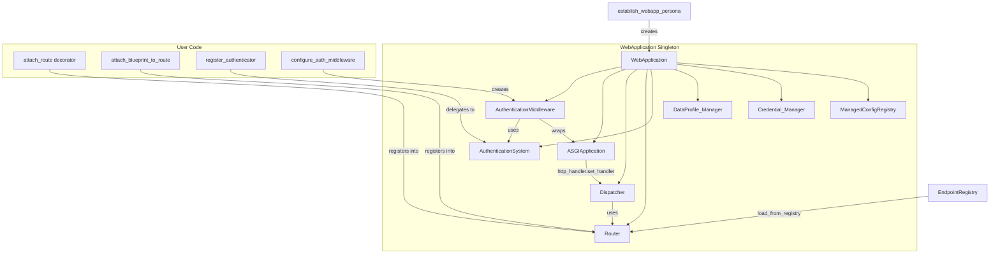
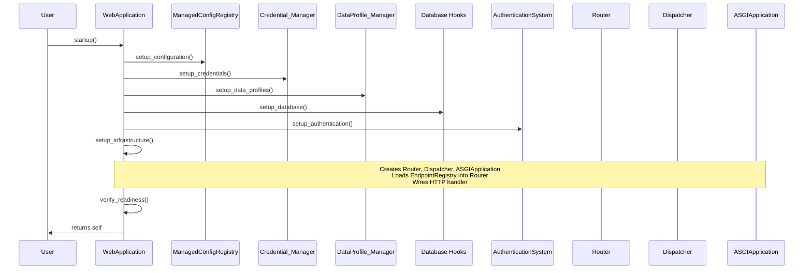

# Design Document: WebApplication Lifecycle

## Overview

This design extends the `WebApplication` singleton to become the central orchestrator for the full lifecycle of a web application. Today, every application entry point (e.g., `helloworld/app.py`, `blueprintdemo/app.py`) manually creates a `Router`, `Dispatcher`, and `ASGIApplication`, loads endpoints from the `EndpointRegistry`, and wires the HTTP handler. This feature moves all of that boilerplate into `WebApplication` and adds lifecycle management for configuration, credentials, data profiles, and authentication.

After this change, a minimal application entry point looks like:

```python
from automojo.webworks.persona.establish import establish_webapp_persona

# Import handlers to trigger attach_at registration
import myapp.endpoints.handlers  # noqa: F401

app = establish_webapp_persona(name="myapp", logger_name="myapp", log_basename="myapp")
app.startup()

# The ASGI callable is app.asgi_app
```

The `WebApplication` enforces a deterministic startup sequence so that subsystems are initialized in dependency order. Each phase is an overridable method, enabling subclasses to customize individual steps without replacing the entire lifecycle.

## Architecture



### Lifecycle Phase Sequence



### Shutdown Sequence

Shutdown tears down subsystems in reverse lifecycle order:

1. ASGIApplication (stop accepting requests)
2. AuthenticationMiddleware (if configured)
3. AuthenticationSystem (clear authenticators)
4. Database hooks (disconnect)
5. DataProfile_Manager (release)
6. Credential_Manager (release)
7. ManagedConfigRegistry (cleanup watchers, sources)

## Components and Interfaces

### Lifecycle Phase Enum

A string enum tracking which phases have completed, used for dependency enforcement.

```python
class LifecyclePhase(str, Enum):
    CREATED = "created"
    CONFIGURED = "configured"
    CREDENTIALS_LOADED = "credentials_loaded"
    DATA_PROFILES_LOADED = "data_profiles_loaded"
    DATABASE_READY = "database_ready"
    AUTHENTICATION_READY = "authentication_ready"
    INFRASTRUCTURE_READY = "infrastructure_ready"
    READY = "ready"
    SHUTDOWN = "shutdown"
```

### LifecycleError

A new exception raised when a caller attempts an operation that depends on a phase that has not yet completed.

```python
class LifecycleError(SemanticError):
    def __init__(self, operation: str, required_phase: LifecyclePhase, current_phase: LifecyclePhase):
        ...
```

### WebApplication (Extended)

New properties and methods added to the existing `WebApplication` class:

```python
class WebApplication(ThisApplication):

    # --- Properties (read-only) ---
    @property
    def router(self) -> Router: ...

    @property
    def dispatcher(self) -> Dispatcher: ...

    @property
    def asgi_app(self) -> ASGIApplication: ...

    @property
    def config(self) -> ManagedConfigRegistry: ...

    @property
    def credentials(self) -> Credential_Manager: ...

    @property
    def data_profiles(self) -> DataProfile_Manager: ...

    @property
    def auth_system(self) -> AuthenticationSystem: ...

    @property
    def current_phase(self) -> LifecyclePhase: ...

    # --- Registration API ---
    def attach_route(
        self,
        path: str,
        methods: Optional[List[str]] = None,
        **kwargs
    ) -> Callable[[F], F]: ...

    def attach_blueprint_to_route(
        self,
        blueprint_cls: Type[RestBlueprint]
    ) -> None: ...

    # --- Authentication API ---
    def register_authenticator(
        self,
        authenticator: Authenticator,
        priority: int = 0
    ) -> None: ...

    def configure_auth_middleware(
        self,
        exclude_paths: Optional[Set[str]] = None,
        optional_paths: Optional[Set[str]] = None,
        path_policies: Optional[Dict[str, AccessPolicy]] = None,
        default_policy: Optional[AccessPolicy] = None,
        realm: str = "Restricted"
    ) -> AuthenticationMiddleware: ...

    # --- Lifecycle Methods (overridable) ---
    def setup_configuration(self) -> None: ...
    def setup_credentials(self) -> None: ...
    def setup_data_profiles(self) -> None: ...
    def setup_database(self) -> None: ...
    def setup_authentication(self) -> None: ...
    def setup_infrastructure(self) -> None: ...
    def verify_readiness(self) -> None: ...

    # --- Lifecycle Orchestration ---
    def startup(self) -> 'WebApplication': ...
    def shutdown(self) -> None: ...

    # --- Phase Enforcement ---
    def _require_phase(self, required: LifecyclePhase, operation: str) -> None: ...
    def _advance_phase(self, phase: LifecyclePhase) -> None: ...
```


### attach_route Decorator

The `attach_route` method on `WebApplication` is an instance method that returns a decorator. It creates an `EndpointDescriptor` and registers it directly into the `WebApplication`'s `Router` instance (bypassing the global `EndpointRegistry`). This provides a single entry point for handler registration that is scoped to the application instance.

```python
@app.attach_route("/api/status", methods=["GET"])
def get_status(request: Request) -> JSONResponse:
    return JSONResponse(content={"status": "ok"})
```

Design decisions:
- `attach_route` registers directly into the Router (not the global EndpointRegistry) because the WebApplication owns the Router. This avoids global state pollution when multiple test applications exist.
- The decorator preserves the original function using `functools.wraps`.
- Conflict detection reuses the Router's existing `_check_conflict` logic, which raises `RoutingError`. The `attach_route` method catches `RoutingError` and re-raises as `EndpointConflictError` for API consistency with the requirements.
- If `attach_route` is called before `setup_infrastructure` has completed, the route is queued in a `_pending_routes` list and flushed into the Router during `setup_infrastructure`. This allows decorators to be applied at import time before `startup()` is called.

### attach_blueprint_to_route Method

Registers all endpoints from a `RestBlueprint` subclass into the Router. Tracks registered blueprint classes to detect duplicate registration.

```python
app.attach_blueprint_to_route(ItemsBlueprint)
```

Design decisions:
- Uses `RestBlueprint.register(router=self._router)` to load the blueprint's descriptors into the Router, preserving the existing base path, tag merging, and version inheritance behavior.
- Maintains a `_registered_blueprints: Set[Type[RestBlueprint]]` to detect and reject duplicate registration with a descriptive error.
- Like `attach_route`, if called before infrastructure is ready, the blueprint class is queued in `_pending_blueprints` and flushed during `setup_infrastructure`.

### configure_auth_middleware Method

Creates an `AuthenticationMiddleware` instance wired to the `ASGIApplication` and `AuthenticationSystem`. This method requires that `setup_infrastructure` has already completed (the ASGIApplication must exist).

```python
middleware = app.configure_auth_middleware(
    exclude_paths={"/health", "/public"},
    default_policy=AccessPolicy(require_auth=True),
    realm="MyApp"
)
```

Design decisions:
- Raises `LifecycleError` if called before `INFRASTRUCTURE_READY` phase.
- Delegates to the existing `AuthenticationMiddleware` constructor.
- Stores the middleware reference on the WebApplication for shutdown cleanup.

### Phase Enforcement

The `_require_phase` method compares the current phase ordinal against the required phase ordinal. If the current phase has not reached the required phase, it raises `LifecycleError` with a message naming the missing prerequisite.

```python
def _require_phase(self, required: LifecyclePhase, operation: str) -> None:
    phase_order = list(LifecyclePhase)
    if phase_order.index(self._current_phase) < phase_order.index(required):
        raise LifecycleError(
            operation=operation,
            required_phase=required,
            current_phase=self._current_phase
        )
```

### setup_infrastructure Method

This is the core wiring method that replaces the boilerplate in `app.py` files:

1. Creates a `Router` instance.
2. Loads all `EndpointDescriptor` instances from the global `EndpointRegistry` into the Router via `router.load_from_registry(registry=EndpointRegistry)`.
3. Flushes any pending routes from `attach_route` calls into the Router.
4. Flushes any pending blueprints from `attach_blueprint_to_route` calls into the Router.
5. Creates a `Dispatcher` configured with the Router.
6. Creates an `ASGIApplication` via `create_asgi_application()`.
7. Wires the ASGIApplication HTTP handler to `dispatcher.dispatch_async`.
8. Advances phase to `INFRASTRUCTURE_READY`.

### startup Method

Executes all lifecycle phases in order:

```python
def startup(self) -> 'WebApplication':
    self.setup_configuration()
    self.setup_credentials()
    self.setup_data_profiles()
    self.setup_database()
    self.setup_authentication()
    self.setup_infrastructure()
    self.verify_readiness()
    return self
```

Each `setup_*` method advances the phase after successful completion. If any phase raises an exception, startup halts and the exception propagates.

### shutdown Method

Tears down subsystems in reverse order:

```python
def shutdown(self) -> None:
    # Reverse order teardown
    self._asgi_app = None
    self._dispatcher = None
    self._router = None
    self._auth_middleware = None
    self._auth_system = None
    # Database hooks
    # DataProfile_Manager release
    self._data_profile_manager = None
    # Credential_Manager release
    self._credential_manager = None
    # ManagedConfigRegistry cleanup
    if self._config is not None:
        self._config.cleanup()
    self._config = None
    self._advance_phase(LifecyclePhase.SHUTDOWN)
```

### establish_webapp_persona Integration

The existing `establish_webapp_persona` function continues to work unchanged. It creates the `WebApplication` singleton and wires it into the wellknown modules. The new lifecycle methods are called separately via `app.startup()`. This preserves backward compatibility — existing code that manually wires Router/Dispatcher/ASGIApplication continues to work.

### Subclassing Support

Each lifecycle phase is a separate method that subclasses can override:

```python
class MyWebApplication(WebApplication):
    def setup_configuration(self) -> None:
        # Custom configuration logic
        super().setup_configuration()
        # Additional setup

    def setup_authentication(self) -> None:
        super().setup_authentication()
        self.register_authenticator(MyCustomAuthenticator(), priority=10)
```

The `application_cls` parameter on `establish_webapp_persona` already supports instantiating custom subclasses.

## Data Models

### Internal State on WebApplication

The following private attributes are added to `WebApplication.__init__`:

```python
# Lifecycle tracking
self._current_phase: LifecyclePhase = LifecyclePhase.CREATED

# Subsystem references (None until their setup phase completes)
self._config: Optional[ManagedConfigRegistry] = None
self._credential_manager: Optional[Any] = None  # automojo.credentials manager
self._data_profile_manager: Optional[Any] = None  # automojo.dataprofiles manager
self._auth_system: Optional[AuthenticationSystem] = None
self._auth_middleware: Optional[AuthenticationMiddleware] = None
self._router: Optional[Router] = None
self._dispatcher: Optional[Dispatcher] = None
self._asgi_app: Optional[ASGIApplication] = None

# Deferred registration queues
self._pending_routes: List[Tuple[EndpointDescriptor, ...]] = []
self._pending_blueprints: List[Type[RestBlueprint]] = []
self._registered_blueprints: Set[Type[RestBlueprint]] = set()
```

### LifecyclePhase Enum

```python
class LifecyclePhase(str, Enum):
    CREATED = "created"
    CONFIGURED = "configured"
    CREDENTIALS_LOADED = "credentials_loaded"
    DATA_PROFILES_LOADED = "data_profiles_loaded"
    DATABASE_READY = "database_ready"
    AUTHENTICATION_READY = "authentication_ready"
    INFRASTRUCTURE_READY = "infrastructure_ready"
    READY = "ready"
    SHUTDOWN = "shutdown"
```

Phase ordering is determined by the enum member declaration order. `_require_phase` uses `list(LifecyclePhase).index()` to compare ordinals.

### LifecycleError

```python
class LifecycleError(SemanticError):
    def __init__(self, operation: str, required_phase: LifecyclePhase, current_phase: LifecyclePhase):
        self.operation = operation
        self.required_phase = required_phase
        self.current_phase = current_phase
        errmsg = (
            f"Cannot perform '{operation}': requires phase '{required_phase.value}' "
            f"but current phase is '{current_phase.value}'."
        )
        super().__init__(errmsg)
```

### BlueprintAlreadyRegisteredError

```python
class BlueprintAlreadyRegisteredError(SemanticError):
    def __init__(self, blueprint_cls: Type):
        self.blueprint_cls = blueprint_cls
        errmsg = (
            f"Blueprint '{blueprint_cls.__name__}' has already been registered. "
            f"Duplicate registration is not allowed."
        )
        super().__init__(errmsg)
```

### File Locations

| Component | File |
|-----------|------|
| `LifecyclePhase` | `source/packages/automojo/webworks/persona/lifecycle.py` |
| `LifecycleError` | `source/packages/automojo/webworks/persona/lifecycle.py` |
| `BlueprintAlreadyRegisteredError` | `source/packages/automojo/webworks/persona/lifecycle.py` |
| `WebApplication` (extended) | `source/packages/automojo/webworks/persona/webapplication.py` |


## Correctness Properties

*A property is a characteristic or behavior that should hold true across all valid executions of a system — essentially, a formal statement about what the system should do. Properties serve as the bridge between human-readable specifications and machine-verifiable correctness guarantees.*

### Property 1: Startup initializes all subsystems

*For any* valid persona configuration, after calling `startup()` on a `WebApplication`, the properties `router`, `dispatcher`, `asgi_app`, `config`, `credentials`, `data_profiles`, and `auth_system` shall all return non-None instances of their expected types (`Router`, `Dispatcher`, `ASGIApplication`, `ManagedConfigRegistry`, credential manager, data profile manager, `AuthenticationSystem` respectively), and `current_phase` shall be `READY`.

**Validates: Requirements 1.1, 1.2, 1.3, 4.1, 5.1, 6.1, 7.1, 8.3**

### Property 2: Infrastructure wiring consistency

*For any* `WebApplication` after `startup()` completes, the `Dispatcher`'s `router` property shall return the same `Router` object as `WebApplication.router` (identity check), and all `EndpointDescriptor` instances that were in the `EndpointRegistry` at startup time shall be matchable via the `Router`.

**Validates: Requirements 1.4, 1.5, 1.6**

### Property 3: attach_route registers routable endpoints

*For any* valid URL path string and list of HTTP methods, applying the `attach_route` decorator to a handler function and then calling `startup()` shall result in the `Router` successfully matching a request to that path and method to the decorated handler.

**Validates: Requirements 2.1**

### Property 4: attach_route conflict detection

*For any* URL path and HTTP method, if `attach_route` is used to register a handler at that path and method, then using `attach_route` again with the same path and method shall raise an `EndpointConflictError`.

**Validates: Requirements 2.2**

### Property 5: attach_route preserves function metadata

*For any* function with a `__name__` and `__doc__` attribute, after applying the `attach_route` decorator, the returned function shall have the same `__name__` and `__doc__` as the original.

**Validates: Requirements 2.3**

### Property 6: attach_blueprint_to_route registers all blueprint endpoints

*For any* `RestBlueprint` subclass with registered endpoints, calling `attach_blueprint_to_route` and then `startup()` shall result in every endpoint path defined by the blueprint being matchable in the `Router`, with the base path, tags, and version preserved as defined by `RestBlueprint.attach_at`.

**Validates: Requirements 3.1, 3.3**

### Property 7: Duplicate blueprint registration raises error

*For any* `RestBlueprint` subclass, calling `attach_blueprint_to_route` twice with the same class shall raise a `BlueprintAlreadyRegisteredError` on the second call.

**Validates: Requirements 3.2**

### Property 8: register_authenticator delegates to AuthenticationSystem

*For any* `Authenticator` instance and priority integer, calling `register_authenticator` on the `WebApplication` shall result in the `AuthenticationSystem` containing that authenticator retrievable by its scheme, and the scheme appearing in the registered schemes list.

**Validates: Requirements 7.2**

### Property 9: configure_auth_middleware creates properly wired middleware

*For any* set of exclude paths, optional paths, path policies, default policy, and realm string, calling `configure_auth_middleware` after infrastructure setup shall return an `AuthenticationMiddleware` whose `app` property is the `WebApplication`'s `asgi_app` and whose `auth_system` property is the `WebApplication`'s `auth_system`.

**Validates: Requirements 7.3**

### Property 10: Lifecycle phase ordering enforcement

*For any* lifecycle method that depends on a prior phase, calling that method before its prerequisite phase has completed shall raise a `LifecycleError` whose message names the missing prerequisite phase and the attempted operation.

**Validates: Requirements 8.1, 8.2, 7.4**

### Property 11: Shutdown releases all resources

*For any* `WebApplication` that has completed `startup()`, calling `shutdown()` shall result in `current_phase` being `SHUTDOWN`, and the `config` registry's `cleanup()` having been called.

**Validates: Requirements 8.4**

### Property 12: Subclass overrides are invoked during startup

*For any* `WebApplication` subclass that overrides one or more lifecycle phase methods, calling `startup()` shall invoke the overridden methods (not the base implementations) in the correct lifecycle order.

**Validates: Requirements 9.2**

## Error Handling

| Scenario | Error Type | Details |
|----------|-----------|---------|
| `attach_route` with conflicting path+method | `EndpointConflictError` | Message includes path, method, existing handler name, and new handler name |
| `attach_blueprint_to_route` with already-registered blueprint | `BlueprintAlreadyRegisteredError` | Message includes blueprint class name |
| Lifecycle method called out of order | `LifecycleError` | Message includes operation name, required phase, and current phase |
| `configure_auth_middleware` before infrastructure ready | `LifecycleError` | Required phase: `INFRASTRUCTURE_READY` |
| Configuration loading fails | `ConfigurationError` / `ConfigurationValidationError` | Propagated from `ManagedConfigRegistry` with source path and validation details |
| Credential store not found | `SemanticError` | Message includes expected credential store path derived from presence directory |
| Data profile source not found | `SemanticError` | Message includes expected data profile source path derived from presence directory |
| Property access before phase completes | `LifecycleError` | e.g., accessing `router` before `INFRASTRUCTURE_READY` raises error naming the prerequisite |

Design decisions on error handling:
- Errors from subsystem initialization (configuration, credentials, data profiles) propagate directly — the `WebApplication` does not wrap them in a generic lifecycle error. This preserves the specific error types and messages from each subsystem.
- `LifecycleError` extends `SemanticError` (from `automojo.errors.exceptions`) to stay consistent with the existing error hierarchy.
- Property accessors (e.g., `router`, `config`) raise `LifecycleError` if the corresponding phase has not completed, rather than returning `None`. This fails fast with a clear message instead of producing confusing `AttributeError` downstream.

## Testing Strategy

### Framework

All tests use the `testbase` framework with `test_` prefix functions. Mock objects use `automojo.testbase.mocking.Mock`. No pytest, unittest, or hypothesis.

### Dual Testing Approach

- **Unit tests**: Verify specific examples, edge cases, and error conditions (configuration failure messages, credential store not found, out-of-order calls).
- **Property tests**: Verify universal properties across generated inputs (random paths for attach_route, random authenticators for register_authenticator, random phase orderings for lifecycle enforcement).

### Property-Based Testing Configuration

- Library: The `testbase` framework's built-in test infrastructure with data-driven iteration over generated inputs. Since the project does not use hypothesis, property tests will use helper generators that produce randomized inputs and iterate a minimum of 100 times per property.
- Each property test is tagged with a comment: `Feature: webapp-lifecycle, Property {number}: {property_text}`
- Each correctness property is implemented by a single property-based test function.

### Test File Layout

Tests mirror the source hierarchy per project conventions:

```
source/testroots/automojo/tests/singlehost/webworks/persona/
├── __init__.py
├── test_webapplication_lifecycle.py          # Unit: startup/shutdown, phase ordering, error cases
├── test_webapplication_routing.py            # Unit: attach_route, attach_blueprint_to_route
├── test_webapplication_auth.py               # Unit: register_authenticator, configure_auth_middleware
├── test_property_lifecycle.py                # Property: Properties 1, 2, 10, 11, 12
├── test_property_routing.py                  # Property: Properties 3, 4, 5, 6, 7
└── test_property_auth.py                     # Property: Properties 8, 9
```

### Unit Tests (test_webapplication_lifecycle.py)

- Verify `startup()` returns the WebApplication instance
- Verify `shutdown()` sets phase to SHUTDOWN
- Verify calling `setup_infrastructure` before `setup_configuration` raises `LifecycleError`
- Verify configuration failure propagates with source path in message
- Verify credential store not found raises error with expected path
- Verify data profile source not found raises error with expected path
- Verify `setup_from_persona` is called during `setup_configuration`
- Verify `establish_webapp_persona` with `application_cls` creates the correct subclass

Covers: Requirements 4.2, 4.3, 5.2, 5.3, 6.2, 6.3, 8.1, 8.2, 8.3, 8.4, 9.3

### Unit Tests (test_webapplication_routing.py)

- Verify `attach_route` with a specific path and method makes the handler routable
- Verify `attach_route` conflict raises `EndpointConflictError` with descriptive message
- Verify `attach_blueprint_to_route` loads all blueprint endpoints
- Verify duplicate blueprint registration raises `BlueprintAlreadyRegisteredError`
- Verify `attach_route` called before startup queues the route and flushes during startup
- Verify `attach_blueprint_to_route` called before startup queues and flushes during startup

Covers: Requirements 2.1, 2.2, 2.3, 3.1, 3.2, 3.3

### Unit Tests (test_webapplication_auth.py)

- Verify `register_authenticator` adds authenticator to auth system
- Verify `configure_auth_middleware` creates middleware with correct properties
- Verify `configure_auth_middleware` before infrastructure raises `LifecycleError`

Covers: Requirements 7.1, 7.2, 7.3, 7.4

### Property Tests (test_property_lifecycle.py)

- **Property 1 test**: Generate random persona configurations (varying name, logger_name, presence_dir), call startup, verify all subsystem properties are non-None and of correct type, and phase is READY.
  Tag: `Feature: webapp-lifecycle, Property 1: Startup initializes all subsystems`
- **Property 2 test**: Register random EndpointDescriptors in the EndpointRegistry, call startup, verify each descriptor is matchable in the Router and the Dispatcher's router is the same object.
  Tag: `Feature: webapp-lifecycle, Property 2: Infrastructure wiring consistency`
- **Property 10 test**: For each pair of (lifecycle method, prerequisite phase), call the method before the prerequisite and verify LifecycleError is raised with the correct phase names.
  Tag: `Feature: webapp-lifecycle, Property 10: Lifecycle phase ordering enforcement`
- **Property 11 test**: Generate random persona configurations, call startup then shutdown, verify phase is SHUTDOWN and config cleanup was called.
  Tag: `Feature: webapp-lifecycle, Property 11: Shutdown releases all resources`
- **Property 12 test**: Create subclasses that override each lifecycle method with a tracking wrapper, call startup, verify each override was called in the correct order.
  Tag: `Feature: webapp-lifecycle, Property 12: Subclass overrides are invoked during startup`

### Property Tests (test_property_routing.py)

- **Property 3 test**: Generate random valid URL paths and HTTP methods, apply attach_route, call startup, verify Router matches each path+method to the correct handler.
  Tag: `Feature: webapp-lifecycle, Property 3: attach_route registers routable endpoints`
- **Property 4 test**: Generate random path+method pairs, register once via attach_route, attempt to register again, verify EndpointConflictError is raised.
  Tag: `Feature: webapp-lifecycle, Property 4: attach_route conflict detection`
- **Property 5 test**: Generate functions with random __name__ and __doc__ values, apply attach_route, verify the returned function preserves both attributes.
  Tag: `Feature: webapp-lifecycle, Property 5: attach_route preserves function metadata`
- **Property 6 test**: Create RestBlueprint subclasses with random base paths and endpoint leaves, call attach_blueprint_to_route, call startup, verify all expected paths are matchable in the Router.
  Tag: `Feature: webapp-lifecycle, Property 6: attach_blueprint_to_route registers all blueprint endpoints`
- **Property 7 test**: Create random RestBlueprint subclasses, call attach_blueprint_to_route twice, verify BlueprintAlreadyRegisteredError on second call.
  Tag: `Feature: webapp-lifecycle, Property 7: Duplicate blueprint registration raises error`

### Property Tests (test_property_auth.py)

- **Property 8 test**: Generate mock Authenticator instances with random scheme names and priorities, call register_authenticator, verify the AuthenticationSystem contains each authenticator by scheme.
  Tag: `Feature: webapp-lifecycle, Property 8: register_authenticator delegates to AuthenticationSystem`
- **Property 9 test**: Generate random sets of exclude paths, optional paths, policies, and realm strings, call configure_auth_middleware after startup, verify the returned middleware's app and auth_system properties match the WebApplication's.
  Tag: `Feature: webapp-lifecycle, Property 9: configure_auth_middleware creates properly wired middleware`
