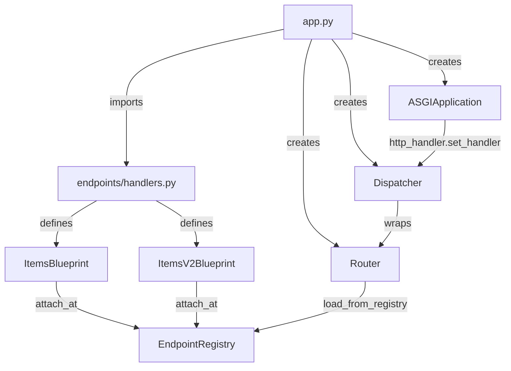

# Design Document: Blueprint Test Site

## Overview

This design describes a test site at `source/testsites/blueprintdemo/` that demonstrates two Blueprint usage patterns:

1. Creating a `Blueprint` subclass (`ItemsBlueprint`) with multiple endpoints registered via `Blueprint.attach_at` under a shared `base_path`.
2. Subclassing that Blueprint (`ItemsV2Blueprint`) to override one endpoint handler while inheriting the rest.

The test site follows the same structural conventions as the existing `helloworld` test site. It wires both Blueprints into a single ASGI application via `Router`, `Dispatcher`, and `create_asgi_application`, exposing module-level `app`, `router`, and `dispatcher` variables for test access.

The test suite lives at `source/testroots/automojo/tests/singlehost/webworks/testsites/blueprintdemo/` and uses the `testbase` framework exclusively.

## Architecture



The data flow mirrors the helloworld site exactly:

1. Importing `endpoints.handlers` triggers `Blueprint.attach_at` decorators, which register `EndpointDescriptor` records with the global `EndpointRegistry`.
2. `app.py` creates a `Router` and calls `router.load_from_registry(registry=EndpointRegistry)` to load all registered descriptors.
3. A `Dispatcher` wraps the `Router` to handle request matching, 404, and 405 responses.
4. An `ASGIApplication` is created via `create_asgi_application()` and its HTTP handler is wired to `dispatcher.dispatch_async`.

## Components and Interfaces

### Test Site Source Files

#### `source/testsites/blueprintdemo/__init__.py`
Empty init file for package recognition.

#### `source/testsites/blueprintdemo/endpoints/__init__.py`
Empty init file for subpackage recognition.

#### `source/testsites/blueprintdemo/endpoints/handlers.py`

Defines two Blueprint subclasses and their handler functions.

```python
from automojo.webworks.endpoints.blueprint import Blueprint
from automojo.webworks.routing.request import Request
from automojo.webworks.routing.response import JSONResponse


class ItemsBlueprint(Blueprint):
    base_path = "/api/items"
    methods = ["GET"]

    @Blueprint.attach_at(leaf="list", methods=["GET"])
    def list_items(request: Request) -> JSONResponse: ...

    @Blueprint.attach_at(leaf="detail", methods=["GET"])
    def get_item(request: Request) -> JSONResponse: ...

    @Blueprint.attach_at(leaf="create", methods=["POST"])
    def create_item(request: Request) -> JSONResponse: ...


class ItemsV2Blueprint(ItemsBlueprint):
    base_path = "/api/v2/items"

    @ItemsBlueprint.attach_at(leaf="list", methods=["GET"])
    def list_items(request: Request) -> JSONResponse: ...
```

Key design decisions:
- `ItemsBlueprint` uses `Blueprint.attach_at` (not `ItemsBlueprint.attach_at`) because `attach_at` is a classmethod on Blueprint that composes paths relative to the calling class's `base_path`. The handlers are module-level functions decorated at class definition time.
- `ItemsV2Blueprint` subclasses `ItemsBlueprint` and sets a different `base_path`. It overrides only `list_items`; the `get_item` and `create_item` handlers are inherited from `ItemsBlueprint` and registered under the original `/api/items` base path. The v2 list endpoint is registered under `/api/v2/items/list`.
- The `methods` class attribute on `ItemsBlueprint` sets a default of `["GET"]` that child handlers inherit unless overridden (e.g., `create_item` explicitly sets `methods=["POST"]`).

#### `source/testsites/blueprintdemo/app.py`

Wires the application following the same pattern as `helloworld/app.py`:

```python
from automojo.webworks.asgi.application import create_asgi_application
from automojo.webworks.endpoints.registry import EndpointRegistry
from automojo.webworks.routing.dispatcher import Dispatcher
from automojo.webworks.routing.router import Router

from blueprintdemo.endpoints import handlers  # noqa: F401

router = Router()
router.load_from_registry(registry=EndpointRegistry)

dispatcher = Dispatcher(router=router)

app = create_asgi_application()
app.http_handler.set_handler(handler=dispatcher.dispatch_async)
```

Exposes module-level `app`, `router`, `dispatcher` for test access.

### Handler Signatures and Responses

| Handler | Path | Method | Status | Response Body |
|---------|------|--------|--------|---------------|
| `list_items` (base) | `/api/items/list` | GET | 200 | `{"items": [{"id": 1, "name": "Widget"}, {"id": 2, "name": "Gadget"}]}` |
| `get_item` | `/api/items/detail` | GET | 200 | `{"id": 1, "name": "Widget"}` |
| `create_item` | `/api/items/create` | POST | 201 | `{"id": 3, "name": "NewItem", "created": true}` |
| `list_items` (v2) | `/api/v2/items/list` | GET | 200 | `{"items": [{"id": 1, "name": "Widget", "version": "v2"}, {"id": 2, "name": "Gadget", "version": "v2"}], "total": 2}` |
| `get_item` (inherited) | `/api/items/detail` | GET | 200 | Same as base (inherited, not re-registered under v2) |
| `create_item` (inherited) | `/api/items/create` | POST | 201 | Same as base (inherited, not re-registered under v2) |

### Test Suite Files

All tests reside at `source/testroots/automojo/tests/singlehost/webworks/testsites/blueprintdemo/`:

| File | Purpose |
|------|---------|
| `__init__.py` | Empty init for package |
| `test_handlers.py` | Direct handler invocation tests (response type, status, body) |
| `test_app_wiring.py` | Wiring tests (app/router/dispatcher instantiation, route registration) |
| `test_dispatch.py` | Dispatcher routing tests (correct handler dispatch, 404, 405) |
| `test_property_blueprint_responses.py` | Property-based tests for response correctness across all endpoints |

## Data Models

### Static Item Data

The handlers use hardcoded item data (no database). This keeps the test site focused on demonstrating Blueprint patterns rather than data access.

```python
ITEMS = [
    {"id": 1, "name": "Widget"},
    {"id": 2, "name": "Gadget"},
]
```

### Response Structures

All handlers return `JSONResponse` instances. The response bodies are plain Python dicts serialized by `JSONResponse`:

- List response: `{"items": [<item_dict>, ...]}` 
- Detail response: `{"id": <int>, "name": <str>}`
- Create response: `{"id": <int>, "name": <str>, "created": true}`
- V2 list response: `{"items": [<item_dict_with_version>, ...], "total": <int>}`

### EndpointDescriptor Records

Each `Blueprint.attach_at` call creates an `EndpointDescriptor` with:
- `handler`: The decorated function
- `module`: `"blueprintdemo.endpoints.handlers"`
- `path`: Composed from `base_path + "/" + leaf` (e.g., `"/api/items/list"`)
- `methods`: As specified in the decorator
- `constraints`: Inherited from Blueprint class (default: no access policy, no rate limit)


## Correctness Properties

*A property is a characteristic or behavior that should hold true across all valid executions of a system — essentially, a formal statement about what the system should do. Properties serve as the bridge between human-readable specifications and machine-verifiable correctness guarantees.*

The prework analysis identified three non-redundant testable properties from the acceptance criteria. Requirements 4.2 and 4.3 were combined into a single property since they both test the same invariant (correct dispatch) across different Blueprint instances.

### Property 1: Endpoint Response Correctness

*For any* registered endpoint path and its allowed HTTP method across both `ItemsBlueprint` and `ItemsV2Blueprint`, the Dispatcher SHALL return a response whose status code and body content match the expected values for that endpoint.

**Validates: Requirements 4.2, 4.3**

### Property 2: Not Found Consistency

*For any* request path that does not match any registered endpoint, the Dispatcher SHALL return a response with status code 404 and a non-empty body.

**Validates: Requirements 4.4**

### Property 3: Method Not Allowed Consistency

*For any* registered endpoint path and any HTTP method not in that endpoint's allowed methods list, the Dispatcher SHALL return a response with status code 405 and an `Allow` header that contains all permitted methods for that path.

**Validates: Requirements 4.5**

## Error Handling

| Scenario | Behavior |
|----------|----------|
| Request to unregistered path | Dispatcher returns 404 with HTML error body |
| Request with disallowed HTTP method | Dispatcher returns 405 with `Allow` header listing permitted methods |
| Blueprint `attach_at` called without `leaf` or `path` | Raises `EndpointRegistrationError` at import time |
| Duplicate path+method registration | Raises `EndpointConflictError` at import time (default `on_conflict="error"`) |

Error handling is delegated entirely to the existing `Dispatcher` implementation. The test site handlers themselves do not raise exceptions — they return static JSON data. The Dispatcher's `_handle_http_exception` method produces the 404/405 responses.

## Testing Strategy

### Framework

All tests use the `testbase` framework with `test_` prefix functions. Mock objects use `automojo.testbase.mocking.Mock`. No pytest, unittest, or hypothesis.

### Dual Testing Approach

- Unit tests verify specific examples: each handler's response type, status code, and body; wiring correctness; route registration.
- Property tests verify universal properties across all registered endpoints and a range of unregistered paths/disallowed methods.

### Test File Layout

```
source/testroots/automojo/tests/singlehost/webworks/testsites/blueprintdemo/
├── __init__.py
├── test_handlers.py                        # Unit: direct handler invocation
├── test_app_wiring.py                      # Unit: module-level object types and route registration
├── test_dispatch.py                        # Unit: dispatcher routing for each path
└── test_property_blueprint_responses.py    # Property: Properties 1, 2, 3
```

### Unit Tests (test_handlers.py)

Tests that invoke each handler function directly with a mock `Request` and verify:
- Return type is `JSONResponse`
- Status code matches expected value (200 or 201)
- Body content matches expected JSON structure

Covers: Requirements 2.3, 2.4, 2.5, 3.2, 3.4

### Unit Tests (test_app_wiring.py)

Tests that verify:
- `app` is an `ASGIApplication` instance
- `router` is a `Router` instance
- `dispatcher` is a `Dispatcher` instance
- Router has registered endpoints for all expected paths (`/api/items/list`, `/api/items/detail`, `/api/items/create`, `/api/v2/items/list`)
- Router reports correct allowed methods for each path

Covers: Requirements 1.3, 1.4, 4.1

### Unit Tests (test_dispatch.py)

Tests that verify:
- Dispatcher routes `GET /api/items/list` to the base list handler
- Dispatcher routes `GET /api/items/detail` to the detail handler
- Dispatcher routes `POST /api/items/create` to the create handler
- Dispatcher routes `GET /api/v2/items/list` to the v2 list handler
- V2 list response contains augmented metadata (`version`, `total` fields)
- Non-overridden endpoints return base responses
- Dispatcher returns 404 for `/api/items/nonexistent`
- Dispatcher returns 405 for `POST /api/items/list`

Covers: Requirements 4.2, 4.3, 4.4, 4.5, 5.5

### Property Tests (test_property_blueprint_responses.py)

Each property test iterates over a data-driven set of inputs (registered endpoints, unregistered paths, disallowed methods) to verify universal invariants. Each test runs across all relevant input combinations.

- Property 1 test: Iterates over all registered endpoint specs (path, method, expected status, expected body) for both blueprints.
  Tag: `Feature: blueprint-testsite, Property 1: Endpoint Response Correctness`
- Property 2 test: Iterates over a list of unregistered paths and verifies 404 status with non-empty body.
  Tag: `Feature: blueprint-testsite, Property 2: Not Found Consistency`
- Property 3 test: Iterates over all registered paths and all disallowed methods, verifying 405 status and correct Allow header.
  Tag: `Feature: blueprint-testsite, Property 3: Method Not Allowed Consistency`

Since the test site uses static data (no randomized input generation needed for the handlers themselves), the property tests use exhaustive enumeration over the registered endpoint set and a curated list of unregistered paths. This follows the same pattern as the existing `helloworld/test_property_responses.py`.

Covers: Requirements 4.2, 4.3, 4.4, 4.5
