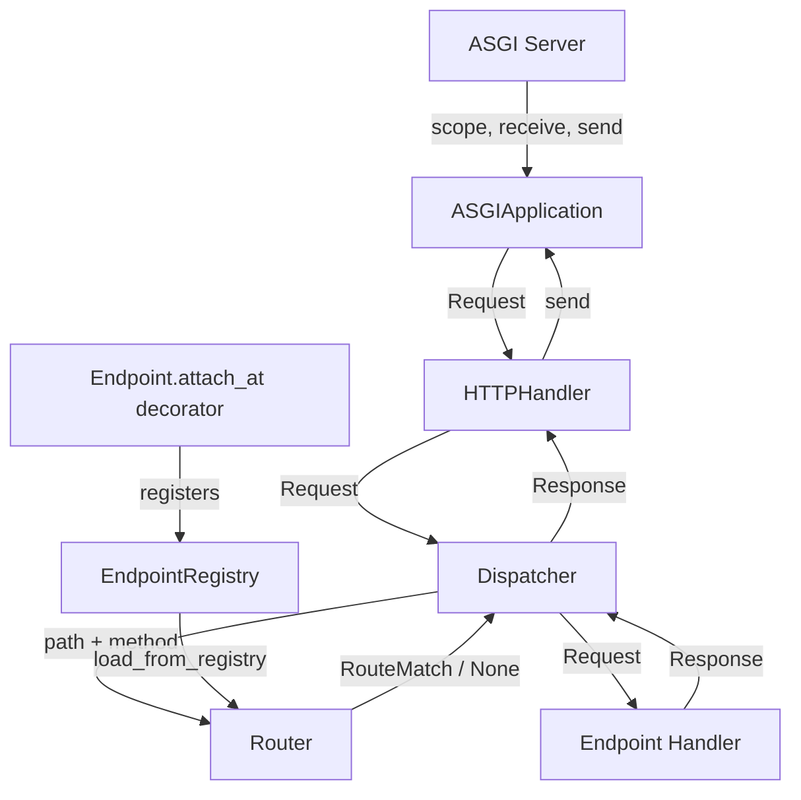

# Design Document: HelloWorld Test Site

## Overview

The helloworld test site is a minimal ASGI web application that validates the core request-response pipeline of the codecraftai-webworks framework. It exercises the `Endpoint` registration system, `Router`, `Dispatcher`, and `ASGIApplication` wiring to serve simple HTTP responses. The site lives at `source/testsites/helloworld/` and establishes the directory layout pattern for all future test sites.

The site registers two endpoints:
- `GET /` — returns an `HTMLResponse` with `"Hello, World!"`
- `GET /health` — returns a `JSONResponse` with `{"status": "ok"}`

Unregistered paths produce a 404 response. Registered paths accessed with unsupported HTTP methods produce a 405 response with an `Allow` header.

## Architecture

The helloworld site follows a layered composition pattern where each framework component is wired together in `app.py`:



### Wiring Sequence

1. Endpoint handlers are decorated with `Endpoint.attach_at(path=..., methods=[...])`, which registers `EndpointDescriptor` objects in the global `EndpointRegistry`.
2. `app.py` creates a `Router` and calls `router.load_from_registry(EndpointRegistry)` to populate routes.
3. `app.py` creates a `Dispatcher` wrapping the `Router`.
4. `app.py` creates an `ASGIApplication` via `create_asgi_application()`.
5. The `HTTPHandler` on the application is configured with `dispatcher.dispatch_async` as its handler.
6. The `ASGIApplication` instance is exposed as the module-level `app` variable.

### Design Decision: Synchronous vs Asynchronous Handlers

The endpoint handlers themselves are synchronous functions (they return a `Response` directly). The `Dispatcher.dispatch_async` method handles both sync and async handlers transparently. This keeps the helloworld site as simple as possible while still exercising the async ASGI pipeline.

### Design Decision: 405 Method Not Allowed

The current `Router.match()` returns `None` for both "path not found" and "path found but method not allowed" cases. The `Dispatcher` treats `None` as a 404. The framework already provides a `MethodNotAllowed` exception (in `ccai.webworks.routing.exceptions`) that accepts an `allowed` parameter and sets the `Allow` header automatically.

To support Requirement 6 (405 responses), the `Router` needs a `get_allowed_methods(path)` method that checks whether a path has any registered handlers regardless of method. The `Dispatcher` can then call this before returning a 404: if the path exists with other methods, it raises `MethodNotAllowed(allowed=allowed_methods)` instead of `NotFound()`. The `Dispatcher._handle_http_exception` already converts `HTTPException` subclasses to proper responses with headers, so the `Allow` header propagates automatically.

## Components and Interfaces

### Endpoint Handlers Module (`source/testsites/helloworld/endpoints/handlers.py`)

Contains the endpoint handler functions decorated with `Endpoint.attach_at`.

| Function | Decorator | Returns |
|---|---|---|
| `hello_world(request: Request) -> HTMLResponse` | `@Endpoint.attach_at(path="/", methods=["GET"])` | `HTMLResponse("Hello, World!", status_code=200)` |
| `health_check(request: Request) -> JSONResponse` | `@Endpoint.attach_at(path="/health", methods=["GET"])` | `JSONResponse({"status": "ok"}, status_code=200)` |

### Application Module (`source/testsites/helloworld/app.py`)

Wires the framework components together and exposes the ASGI application.

| Symbol | Type | Description |
|---|---|---|
| `app` | `ASGIApplication` | Module-level ASGI application instance |

Internal wiring steps:
1. Import `endpoints.handlers` to trigger `Endpoint.attach_at` registration
2. Create `Router` and call `load_from_registry(EndpointRegistry)`
3. Create `Dispatcher(router)`
4. Create `ASGIApplication` via `create_asgi_application()`
5. Set `app.http_handler.set_handler(dispatcher.dispatch_async)`

### Package Init Modules

- `source/testsites/helloworld/__init__.py` — empty, makes the site importable
- `source/testsites/helloworld/endpoints/__init__.py` — empty, makes endpoints importable

## Data Models

This site uses no custom data models. All data flows through existing framework types:

| Type | Module | Usage |
|---|---|---|
| `Request` | `ccai.webworks.routing.request` | Incoming HTTP request |
| `Response` | `ccai.webworks.routing.response` | Base response class |
| `HTMLResponse` | `ccai.webworks.routing.response` | HTML content response (root endpoint) |
| `JSONResponse` | `ccai.webworks.routing.response` | JSON content response (health endpoint) |
| `EndpointDescriptor` | `ccai.webworks.endpoints.descriptor` | Registered endpoint metadata |
| `RouteMatch` | `ccai.webworks.routing.router` | Successful route match result |


## Correctness Properties

*A property is a characteristic or behavior that should hold true across all valid executions of a system—essentially, a formal statement about what the system should do. Properties serve as the bridge between human-readable specifications and machine-verifiable correctness guarantees.*

### Property 1: Endpoint Response Correctness

*For any* GET request to a registered path, the Dispatcher SHALL return a Response whose status code is 200 and whose body matches the expected content for that path. Specifically:
- `GET /` SHALL produce an HTMLResponse with body containing `"Hello, World!"`
- `GET /health` SHALL produce a JSONResponse with body containing `{"status": "ok"}`

**Validates: Requirements 1.3, 3.2**

### Property 2: Not Found Consistency

*For any* request to a path that has no registered endpoint handler, the Dispatcher SHALL return a Response with status code 404 and a non-empty body.

**Validates: Requirements 4.1, 4.2**

### Property 3: Method Not Allowed Consistency

*For any* request to a registered path using an HTTP method that is not in the endpoint's registered methods list, the Dispatcher SHALL return a Response with status code 405 and an `Allow` header listing the permitted methods.

**Validates: Requirements 6.1, 6.2**

## Error Handling

The helloworld site relies entirely on the framework's built-in error handling:

| Scenario | Handler | Response |
|---|---|---|
| Path not found | `Dispatcher` raises `NotFound()` | 404 with error message |
| Method not allowed | `Dispatcher` raises `MethodNotAllowed(allowed=[...])` | 405 with `Allow` header |
| Unhandled exception | `Dispatcher._handle_unhandled_exception` | 500 with optional stack trace |

## Testing Strategy

### Unit Tests

Unit tests should cover:

1. **Endpoint Registration Tests**
   - Verify `hello_world` handler is registered at `/` for GET
   - Verify `health_check` handler is registered at `/health` for GET

2. **Response Content Tests**
   - Verify `GET /` returns HTMLResponse with "Hello, World!" and status 200
   - Verify `GET /health` returns JSONResponse with `{"status": "ok"}` and status 200

3. **Error Handling Tests**
   - Verify unregistered path returns 404
   - Verify POST to `/` returns 405 with `Allow: GET` header

4. **Application Wiring Tests**
   - Verify `app` module-level variable is an ASGIApplication instance
   - Verify the HTTP handler has a dispatch function set

### Property-Based Tests

Property-based tests should use the `testbase` framework. Each test validates a correctness property from the design.

**Testing Framework**: testbase (as specified in AGENTS.md)

### Test Organization

Following the repository conventions:

```
source/testroots/ccai/tests/singlehost/webworks/
└── testsites/
    └── helloworld/
        ├── test_handlers.py              # Endpoint handler unit tests
        ├── test_app_wiring.py            # Application wiring tests
        └── test_property_responses.py    # Property tests for response correctness
```
